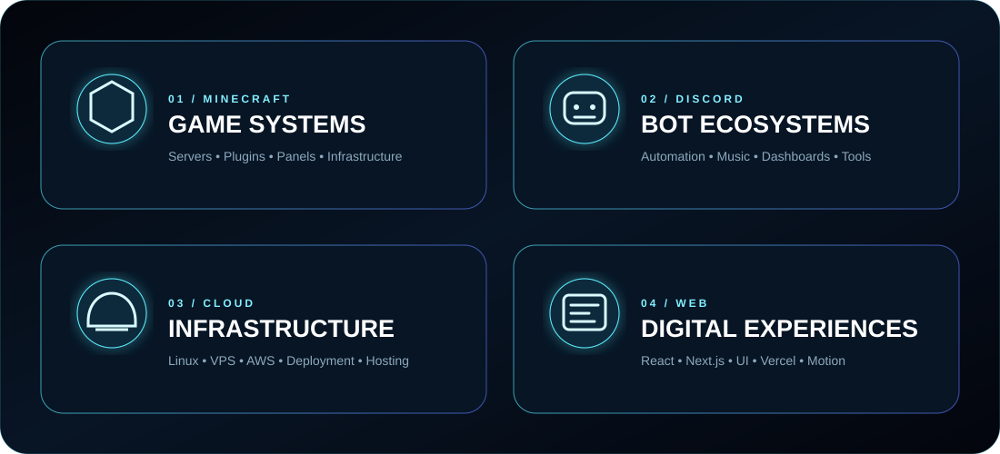
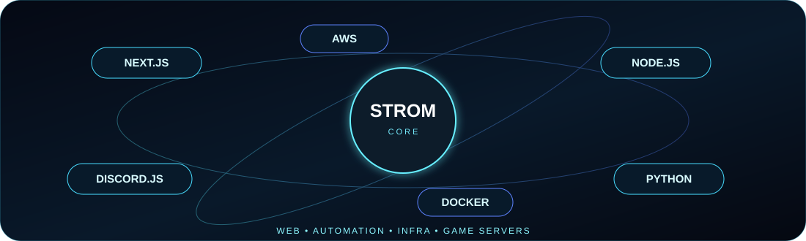
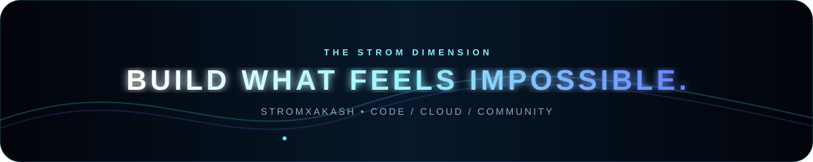

  

  

  

 

  

<table>
<tr>
<td align="center" width="33%">

**BUILDING**

Minecraft systems  
Discord ecosystems  
Next.js experiences

</td>
<td align="center" width="33%">

**FOCUS**

Clean architecture  
Fast deployments  
Premium interfaces

</td>
<td align="center" width="33%">

**MISSION**

Learn → build → ship  
Break → improve → repeat

</td>
</tr>
</table>

 

## 📊 GITHUB CORE

  

  

 

## 🐍 CONTRIBUTION MATRIX

 

 

